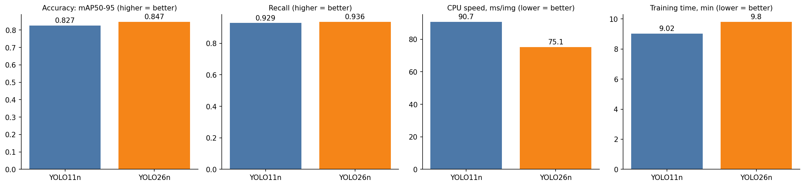
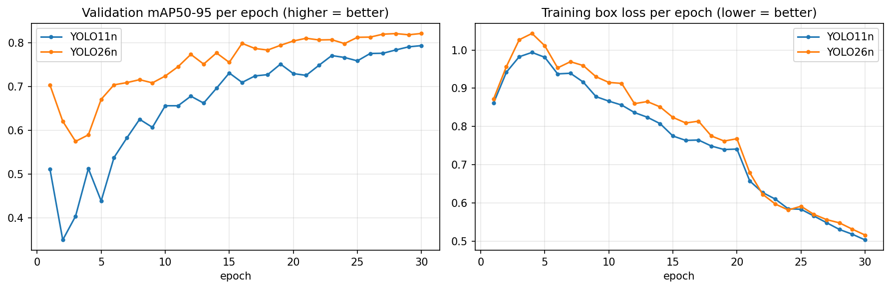
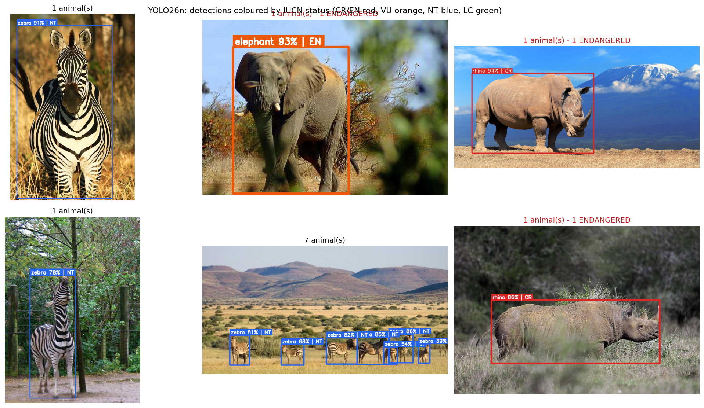

# 🐘 Endangered Wildlife Detector (YOLO11 vs YOLO26)

A beginner-friendly Google Colab project that **custom-trains YOLO11 and YOLO26 on wildlife photos, keeps the better
model, and flags which detected animals are endangered**.

## How it works

| Part | What does it | How |
|---|---|---|
| Which animal, and where? | A **YOLO** object detector, fine-tuned on the [African Wildlife](https://docs.ultralytics.com/datasets/detect/african-wildlife/) dataset (buffalo, elephant, rhino, zebra) | Learned from labelled photos |
| Is it endangered? | A small **IUCN Red List lookup table** (`SPECIES` in the notebook) | Looked up by species name |

The model only recognises the *species*. The endangered flag comes from the table, which you can edit without re-training.

## What the notebook does

1. Installs Ultralytics and checks the GPU
2. Settings (epochs, model size, seed …) in one cell
3. Downloads and explores the dataset
4. Trains **YOLO11** and **YOLO26** with identical settings
5. Scores both on held-out test photos (mAP50-95, precision, recall, per-species)
6. Measures speed (CPU via ONNX, GPU via PyTorch) and **automatically picks the winner**
7. Adds the IUCN endangered-status layer
8. Runs the winner on photos, colour-coding boxes by threat level; you can upload your own photo
9. Exports `best.pt`, `best.onnx`, the species table and metrics as a zip

## Run it

1. Open the notebook in Colab (badge above, or upload `endangered_wildlife_detector.ipynb`).
2. `Runtime → Change runtime type → T4 GPU`.
3. First time? Set `QUICK_TEST = True` in Step 2 and `Runtime → Run all` (a few minutes) to check everything works.
4. Then set `QUICK_TEST = False` and run again for the real result. This is roughly 30–60 minutes on a free T4 (an estimate).

### Saving your results into this repo
After a full run, use **File → Save a copy in GitHub** so the notebook keeps its outputs, and commit the
files from `results/` (`comparison.png`, `comparison.csv`, `predictions.png`, `learning_curves.png`) to show your results here.

## Results

Colab T4 GPU · African Wildlife dataset · 30 epochs · nano models · seed 0 · evaluated on the test split (227 photos)

| | YOLO11n | YOLO26n |
|---|---|---|
| mAP50-95 | 0.827 | **0.847** |
| Precision | 0.969 | **0.976** |
| Recall | 0.929 | **0.936** |
| CPU latency (ONNX, ms/img) | 90.7 | **75.1** |
| GPU latency (PyTorch, ms/img) | **11.1** | 15.5 |
| Training time (min) | **9.0** | 9.8 |
| Parameters / GFLOPs (fused) | 2.60M / 6.4 | **2.39M / 5.4** |

**Winner: YOLO26n**, with higher accuracy and about 17% faster CPU inference. YOLO11n was faster on GPU and trained slightly quicker. This is one run with one seed, so small gaps may be noise.

## Species statuses used

| Dataset class | Species | IUCN | Assessed |
|---|---|---|---|
| elephant | African savanna elephant | Endangered (EN) | 2021 |
| rhino | Black rhino (CR) / white rhino (NT) – worst case shown | Critically Endangered (CR) | 2020 |
| zebra | Plains zebra | Near Threatened (NT) | 2016 |
| buffalo | African buffalo | Near Threatened (NT) | 2019 |

These come from IUCN-related sources, not from a live query. **Confirm on [iucnredlist.org](https://www.iucnredlist.org/)
before relying on them**, since statuses are revised. Elephant context: [IUCN, 2021](https://iucn.org/node/18226).

## Limitations

- Only 4 African savanna species. It will not recognise lions, tigers, etc.
- Class labels hide species-level differences (black vs white rhino).
- Nano models, one seed, 4 classes: small accuracy gaps between models can be noise. The original memo that inspired this
  compared the large `x` models on 120 classes, which may behave differently.
- Not tested on camera-trap night/infrared images.

## Next steps

- Bigger multi-species dataset (Roboflow Universe, Open Images, iNaturalist, LILA camera-trap sets) + extend `SPECIES`
- `MODEL_SIZE = "s"` / `"m"`
- Video input and an alert log
- Gradio / Streamlit demo

## Licence note

Ultralytics YOLO code and weights are **AGPL-3.0** (or a paid Enterprise licence). Check the dataset's licence before
commercial use. Choose a licence for your own repo accordingly.
